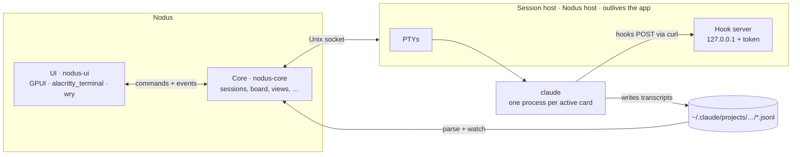

# How Nodus works

The details behind the [README](../README.md): what the app runs, where status comes from, every shortcut, and how to work on the code.



## Sessions

Sessions are ordinary Claude Code sessions. New cards run `claude --session-id <uuid>`, and resuming runs `claude --resume <id>`, so you can continue the same session from any terminal later. Your own settings, hooks and MCP servers still apply.

## Sessions keep running after you quit

The app doesn't run sessions itself. A background process, the session host, owns their terminals, so quitting Nodus (or a crash) leaves them running. Open the app again and the cards are still live, with their recent output and an up-to-date status.

The title bar says how many Claude sessions Nodus is running, in every project. The count includes the ones not drawn on the board, views' brains and action runs, since each holds its own `claude` process and MCP servers. Point at it for how many run in each project. Terminal shells aren't counted. Sessions started in other terminals aren't the app's, so they never count.

The host starts with the first session you open, and runs Nodus's own binary as `Nodus host`, with no window or Dock icon. It also receives the sessions' hooks, and keeps them along with the keypresses that move status (Esc, Ctrl+C, Enter and number keys), so a relaunched app can work out each session's status. The host exits by itself once no sessions are left and the app isn't open. **Quit and Stop Sessions** (⌥⌘Q) stops every session along with the app.

A running session keeps its `claude` process and the MCP servers it started, so each one holds on to memory while it sits idle. To let one go without quitting, press **Stop** in its window or in its expanded card's title bar, or right-click it and choose **Stop session** (with several selected, **Stop 3 sessions**). The process ends and the card stays where it is. Opening it resumes the session. A session in the middle of a turn asks first, since stopping cuts that turn off.

## Terminal cards

Terminal cards run `$SHELL -l` in the repo folder with your login-shell environment. They get no hooks and have no transcript, so they have no status dot. A terminal whose shell has exited starts a fresh shell when you reopen it.

## Expanded cards

A card can expand in place to show its terminal on the board, so you can watch several sessions at once. It's the same terminal as the modal's, so moving between the two keeps the screen. Drag a card's edges or corners to resize it. The board saves each card's size and whether it's expanded. After a restart, an expanded card whose session is still running shows its terminal right away. One whose session has stopped waits for you to click **Resume session** or **Start shell** before it starts anything.

## Status

Status comes from hooks that the app adds for its own processes with `--settings`. Each hook POSTs its payload to a token-protected server on 127.0.0.1, run by the session host:

| Hook | Status |
| --- | --- |
| `UserPromptSubmit`, `PreToolUse`, `PostToolUse` | 🟠 Working |
| `PermissionRequest`, `Notification` (permission or question), `PreToolUse` for `AskUserQuestion` | 🔴 Needs you |
| `Stop`, `SessionEnd`, process exit | 🔵 Done |

Interrupting with Esc or Ctrl+C doesn't fire a hook, so the app watches for those keystrokes as well.

Hooks that fire inside a subagent carry its `agent_id`. Those drive the agent's own status instead (`SubagentStart` and its tool hooks for working, `SubagentStop` for done), and a card reads as working or needing you while any of its agents does.

## Agents

When Claude starts agents with its Agent tool, Claude Code keeps each one's transcript beside the session's, in `<session id>/subagents/agent-<id>.jsonl`, with a `.meta.json` holding its type and the description Claude gave it. The app watches those files.

The agents of the current run (still running, or finished since your last prompt) peek out from under the session's card as a deck, each layer in its status colour. Point at the deck, or the agent count in the card's footer (the 🤖 button in an expanded card's title bar), to fan the agents out beside the card with what each is doing. Click to pin the fan open. Click an agent for the agents viewer: every agent the session has started, with the selected one's task, tool calls and replies, updating while it works. Right-click a card and choose **Agents** to open the viewer for an archived session.

An agent that ends its turn with a command still running in the background isn't done: the command wakes it again when it finishes, so it stays 🟠 meanwhile.

## Notes

Each board has a pad of sticky notes under the archive, and it moves with the archive. Drag the top note off the pad and drop it anywhere on the board, or click the pad for one beside it. A new note opens for writing. Enter starts a new line, and Escape, ⌘Enter or a click away puts the note down. Double-click a note (or select it and press Enter) to write in it again. Drag it to move it, and drag a selected note's corners to resize it. Right-click it to change its colour or delete it. Deleting a note that has writing on it asks first.

Notes sit on top of cards. They don't join sections or the archive: a note dropped on the archive or the pad goes back where it was.

Point at a note with writing on it and press ▶ in its corner (or right-click it and choose **Start session**) to start a Claude session with the note's text as its first prompt, and nothing added. The card takes the note's place and gets to work there, without opening its window. The note then rides on the card as a sticker, a reminder of what was asked: point at it to read all of it, and press its × to delete it. That doesn't ask first, since the text lives on as the session's first prompt. An archived card keeps its sticker out of sight until it's restored. A card removed from the board drops its note back onto the board where the card was.

Claude writes notes too. Ask a session to do some research and put what it found on the board, and it writes notes with its board tools (below). They go up beside its card, one under another, sized to fit what they say, and signed with the session's name: click the name to open the session. Claude can also read the notes on the board and rewrite them, but not delete them.

A session can put notes on another project's board too: ask it to leave a note for the docs project, say, and it finds that project and writes there. Those notes go beside the rightmost card on that board, one under another, and they're signed with the session's name and its project. Click that to go back to the session.

## Views

A view is a small live page on the board, such as a table of your last deployments, a count from your database or your open tickets, that Claude builds from what you describe and keeps up to date. Click **View** in the title bar (or right-click the board › **New view here…**), say what it should show and where the data comes from, and press **Create view**. The view appears straight away and says it's being built. Behind it is its *brain*: a Claude session of its own, in auto mode, that isn't drawn on the board. The view's title bar shows what the brain is doing: 🟠 while it works, 🔴 when it needs you. Press ⌨ in the title bar (or **Watch it work** while it's building) to open the brain's session and talk to it directly.

To change a view, press ✎ and say what to change: it goes to the same brain, which still knows how it built the view. Drag a view by its title bar, and drag a selected view's corners to resize it. ⤢ opens it large. Double-click its title to rename it. Delete it from its menu (or select it and press ⌫), which asks first: its page and data go, and its brain stops. The brain's transcript stays on disk.

A view's page runs in a sandboxed frame of its own, with no network. It can't fetch anything, load anything from the web, reach the board's window or keep browser storage. Links open in your browser. Until you click a view, the page is a picture: clicking selects the view and scrolling over it pans the board. Once it's selected you can use the page. Everything a page gets from the board comes through `window.nodus`, which the app answers for that view alone:

- **Data from Claude.** The page draws from the data its brain sends with `update_view`, which updates the page in place without reloading it.
- **Commands you allow.** A view can declare shell commands, such as `vercel ls --json` or a `psql` count, that run in the project folder with your shell environment, so your CLIs and API tokens work. A new command shows on the card, in full, with **Allow** and **Don't allow**, and nothing runs until you allow it. Your answer goes with that exact command line: change a single character and it asks again, though one Claude puts back exactly as it was keeps your answer. Commands can run on a schedule, such as every hour, and cost no tokens. Each one stops after 2 minutes.
- **Its brain on a schedule.** For data only Claude can fetch, such as tickets from a Linear MCP server, a view can ask its brain to refresh it every so often, at most every 10 minutes. Each refresh is a Claude turn, so it counts toward your usage. ⟳ runs the view's commands and asks its brain to refresh now.
- **The board.** A page can read the board's sessions, notes, git status and the other views with their data, so one view can build on another. It can open a session, and ask its brain something, at most every 15 seconds.
- **Starting sessions, if you ask for it.** A view can't start sessions until you ask its brain for that, such as a **Fix** button beside each failing test. A click on one starts a Claude session beside the view, in auto mode, with what it was asked stuck on its card, the way a note's session wears its note. A view can only start a session within a few seconds of you clicking in it, never by itself, and at most one every 3 seconds. **Stop it starting sessions** in the view's menu turns it off without asking Claude.

Schedules run while the app is open, in the background as well. A brain stops after 5 minutes with nothing to do, and resumes when it's next needed.

Any session can put up a view too: ask it for a dashboard or a table on the board, and it builds one beside its card with its board tools. A view put up that way gets a brain when it first needs one, such as the first time you ask it to change something.

## Board tools

Every Claude session started from the app gets an MCP server named `nodus`, through `--mcp-config`, with tools for its board: `create_note`, `update_note` and `list_notes`, and `create_view`, `update_view`, `get_view` and `list_views` for views. The note tools take an optional `project`, by id or name, to work on another project's board, and `list_projects` lists the projects. `create_project` adds a folder as a project, making the folder if it isn't there, when you ask a session for a new project. `update_view` waits for the board to load a changed page and returns any JavaScript errors it hit, so Claude can fix them. A view's brain can leave out the view's id. `list_board` shows Claude what's on the board and where, and the links touching its own card in words ("→ card “Fix cart rounding” (label: blocks)"), so it knows which work relates to which; nothing is sent to it unless it looks. When you ask, `draw_on_board` draws shapes and links (beside its card, unless told where), `update_drawing` changes them and moves cards, notes and views, and `erase_from_board` takes shapes and links away. Action runs get `list_sessions` and `archive_sessions` as well. They're allowed with `--allowedTools`, so they never stop to ask.

The server lives in the session host, next to the hook server, and passes each request on to the app. So a session keeps its tools when you quit and reopen the app; while the app is closed, a tool call fails and says why. Every process gets the same config, and Claude Code fills in the host's port and token, and the session's id, from the process's environment, so the token never shows up in a process listing. Sessions started outside the app don't get the tools.

## The prompt bar

The prompt bar floats at the bottom of the board, with the mic beside it. Type what you want and press Return: a Claude session starts on it in auto mode, where Claude Code approves routine steps by itself and blocks risky ones, and it stays in auto mode when it resumes. Its card lands expanded in a free spot in view, so you can watch it work there, with your words stuck on it. If the session can't start, your words are left on the board as a note. Shift+Return starts a new line, and **/** on the board jumps into the bar.

Type **/** to make something else: `/view` puts up a view and `/note` a note. The command becomes a token at the start of the bar, and the bar then makes that. A note's token has a swatch for its colour. Backspace in an empty bar, or the token's ×, goes back to a session.

What's selected changes where it goes. With one session selected, the bar shows its name as a token, and Return sends what you typed into that session, as if typed at its prompt. A session that isn't running resumes with it, and while Claude is working it's queued. A session that's waiting on a question isn't sent anything, because Return would answer the question: its card opens for you to answer it first. The token's × starts a new session instead. With more than that selected (sessions, notes or views), the new session starts with them as context: each session's title, branch, last reply and the path of its transcript, each note's text and each view's description, ahead of your prompt. It's named for what you asked, and it starts below the sessions it read, with a line from each. The selection's own actions sit just above the bar.

The mic beside the bar records a prompt (so does **V**): it turns red and swells with your voice, and the bar shows a clock and a level meter. Click it again (or press **V**) to stop, or press Esc to throw the recording away. A click shorter than about half a second is ignored, and a recording stops by itself after five minutes. The recording goes to xAI's speech to text (`grok-voice-transcribe-2.0`), and what you said lands in the bar for review, after anything already typed there. Speak again to add more, then press Return as for anything typed. An open session has its own mic in its title bar, in its window and on its expanded card. What you say there is typed at that session's prompt, not sent, ending with a space so you can keep talking.

Each recording goes with up to 100 hint words, so code names come back spelled as in the repo: the project's name, its branch and the names of the files it has changed. If xAI can't transcribe a recording, it's kept, and **Retry** sends it again.

The xAI API key comes from Settings or from `XAI_API_KEY` in your shell, and a saved one wins. Settings encrypts it with the macOS Keychain before it goes into `state.json`, and it never reaches the window, which only learns where the key comes from. With no key, the mic opens Settings. The first recording asks macOS for the microphone. If you turned it down, the notice links to Privacy & Security › Microphone.

Audio leaves your machine only when you stop a recording, and goes to xAI alone. It counts toward your xAI usage.

## Asking Claude on the spot

The tool dock on the board's left has two tools under the pointer for asking Claude right where you click. With the **bubble** (B) out, the pointer is a chat bubble: click anywhere on the board and a small field opens, pointing at the spot. Type what you want and press Return. It goes at once, and you can open the next one straight away. A marker waits on the spot while Claude (Haiku, a quick call like a capture's guess) decides in the background whether it's a session, a sticky note or a view, and for a session, which model the ask needs: Haiku for small, clear asks, Sonnet for everyday coding work, Opus for hard or open-ended work. Then it lands with its top left on the spot: a session starts as the bar starts one, expanded, in auto mode and with your words stuck on it, and it stays on its model when it resumes. If Claude can't say, a session starts on Claude Code's own model. Several asks can be on their way at once. Shift+Return starts a new line, and Esc puts the bubble away; a bubble you've typed in stays put until you send it or press Esc.

With the **mic** (M) out, click on the board and speak, then click again to send what you said. It's asked at the spot you first clicked, exactly as a bubble is. Esc, or the × on its pill, cancels. It records and transcribes as the bar's mic does.

## Floating capture

Double-tap ⇧ in any app and a panel floats up over it, on the screen the pointer is on, over full-screen apps too. Type what you want, or say it with the mic, and press Return. It becomes a new session, a note, a view or the next prompt of a session that's already running, on the board of the project it belongs to. **File › Capture…** opens the panel too, and **Settings › Floating capture** turns the double tap off.

Each time you pause, Claude guesses what you typed is and where it goes, and the panel's header says so. The guess goes on what you typed, your projects and their recent sessions, and the app in front. It's a short `claude -p` call to Haiku, with no tools. Tab (⇧Tab to go back) moves to the next kind. A click on the header opens a menu with Claude's reason, where you can pick the kind and the project, or for Into, the session. What you pick sticks until you clear the text. If you press Return before Claude has answered, the panel waits for its answer. Each guess is a small Claude request, so it counts toward your usage, and what you type goes to Anthropic before you send it.

What you send lands the way the prompt bar's does. A session starts in auto mode, as an expanded card in a free spot near where you last left the board, with your words stuck on it. A note or a view takes a free spot there. A session that's waiting on you isn't sent anything, since that would answer its question. Once sent, the panel shows what it made for a moment and goes; click it to open it on the board. The next time it opens, your last captures sit under it with their live status.

What comes along:

- **The browser tab in front** (Safari, Chrome, Arc, Dia, Brave, Edge, Vivaldi or Opera): its link and title. macOS asks once for each browser whether Nodus may read it. Firefox has no way to share its tab.
- **A screenshot.** The scan button hides the panel and brings up macOS's crosshair; press Space to pick a window. It needs Screen Recording permission, which macOS doesn't ask for: without it the shot fails once you've picked, and the panel says so, with **Open System Settings** for Privacy & Security › Screen & System Audio Recording.
- **What you copied**, offered as a dashed tile. Click it to add it.
- **Files**, dropped on the panel or picked with the paperclip.

Screenshots and copied images are saved in `captures/` in the app's data folder, and Claude gets their paths. Files go by path too, and the tab and copied text go into the prompt itself. Captures older than 30 days are cleared away.

↑ in an empty field brings back earlier captures. Esc or a click anywhere else puts the panel away, and what you typed is still there the next time.

The double tap is heard through a global key hook (an event tap on a Mac, low-level keyboard and mouse hooks on Windows). Only ⇧ pressed on its own counts: ⇧ held to type a capital or to click doesn't. On a Mac the hook needs Accessibility permission. **Allow…** in Settings asks for it and opens Privacy & Security › Accessibility. macOS keeps the permission with the signature of the copy of Nodus it was given to, so one given to another copy (a build of your own, say) shows as on there but doesn't count. **Allow…** clears that and macOS asks again. Until it's allowed, **File › Capture…** still opens the panel. On Windows it needs no permission. There, the screenshot is the whole screen the pointer is on, and the browser tab isn't read.

## Cards

Cards are read from Claude Code's transcripts in `~/.claude/projects/<encoded-repo-path>/`. Titles use your custom title first, then Claude's generated title, then the first prompt. Parsing is incremental and cached, so large histories load quickly.

## New session from context

For each selected session the app runs `claude -p --resume <id> --fork-session --no-session-persistence`, at most three at a time. The fork writes a handoff summary and is then thrown away, so the original session is never touched. You review and edit the combined summaries, and they become the new session's first prompt.

This makes one Claude request per selected session, so it counts toward your Claude usage like any other prompt.

## Actions

A project's buttons live in a rail on the board's right edge. It hides like the project rail on the left: point at the window's right edge to slide it in. A project starts with none. The **+** button asks what a new one should do, with a few examples to start from. Claude (`claude -p`, Sonnet, able to read the repo but not change it) drafts a name, an icon and the prompt each press runs, and you review and edit them before saving. Right-click a button to run, edit or delete it.

Turn on **Use in every project** to make a button global: it shows in every project's rail, below that project's own buttons, with a globe on its tile. Claude then writes its prompt to work in any repository, finding commands at run time rather than assuming this one's. Turning the switch off moves the button into the project you're in. A project's buttons are stored with it in `state.json`, global ones at the top level of the same file, and never in the repo.

Pressing a button starts a session on the action's prompt. It isn't drawn on the board. Its button turns orange, and while the rail is out the session fans out beside it with what it's doing, so you can click to open it. While the rail is hidden, a sliver on the right edge shows a run is going, and turns red when one needs you. The run gets:

- `--permission-mode auto`, so it never stops to ask permission: Claude Code approves routine steps itself and blocks risky ones.
- the session tools, `list_sessions` and `archive_sessions`, on top of the note tools every session has (see [Board tools](#board-tools)).
- a note asking it to work without stopping to chat, to ask with AskUserQuestion when it needs you, and to end with a one-line summary.

When the run's turn ends, the session goes, its transcript is hidden like a removed card's, and the summary shows as a notice. If you type into a run, or interrupt it with Esc or Ctrl+C, it becomes yours: it joins the board as an ordinary session, and loses its session tools. Answering a question it asked doesn't count. While a run is going, pressing its button opens it rather than starting another.

## Focus

Focus is off until you turn on **Focus mode** in Settings, and until then nothing of it shows. Turned on, it adds a **Focus** switch to the title bar and **Add to Focus** to a project's right-click menu, in the grid and on the rail.

When only a few projects matter this week, put them in focus with **Add to Focus**. A small target marks each one in the grid. Then flip the title bar's **Focus** switch (or press ⌘⇧F, **View › Focus Mode**), and the grid and the board's rail show only the projects in focus. Nothing is archived or regrouped, and flipping it back shows everything again.

While focusing, a project out of focus still shows, faded, while one of its sessions needs you, so nothing waiting on you goes out of sight. The rail also keeps the project whose board is open, for when a notification or a search takes you there. The grid says how many projects it's hiding. With focus mode on but nothing in focus yet, every project shows. Archiving a project takes it out of focus, and a project added while focusing joins the focus.

## Updates

Nodus updates itself from GitHub releases. A little after launch, and every few hours after that, it asks GitHub for the latest release. If that release is newer, Nodus downloads the DMG for your Mac in the background and checks it against the SHA-256 digest GitHub keeps for the file. It then copies the app out of the DMG and checks that the copy's signature is intact, that it's Nodus and that it's the expected version. The new version goes in when you quit, so the next launch opens it. **Restart to Update** in the title bar does that now.

The swap happens after the app has exited: the old app moves aside, the new one takes its place, and the old one is deleted. If the new one can't go in, the old one goes back, and Nodus won't download that version again unless you ask. Sessions keep running in the session host the whole time.

Settings shows the version you're on and how the update is going. **Check Now**, and **Nodus › Check for Updates…**, check right away. Turn off **Download updates automatically** to stop the checks. Nodus can only replace itself in a folder you can write to, so a copy run straight from the DMG doesn't update; move it to Applications first. The downloads live in `updates/` in the app's data folder until they're installed.

## Your data

Transcripts stay where Claude Code keeps them. The app stores only the board layout (projects, card positions, sections, notes, views, archive, custom titles and lineage) and its settings (theme, and the xAI key for voice prompts if you save one, encrypted with the macOS Keychain) in `~/Library/Application Support/Nodus/state.json`. Each view's page, data, saved state and the last output of its commands are kept beside it in `views/<view id>/`, never in your repository. Floating capture keeps its screenshots and copied images in `captures/`, and the list of recent captures in `state.json`. *Remove from board* hides a card and never deletes a transcript.
The session host keeps its socket and log in the `host` folder next to it. Only your user can open the folder, which matters because anything that can connect to the socket can start processes as you.

## Windows

Nodus runs on Windows 10 and 11, on x64 and Arm. The installer puts it in your user folder with a Start menu shortcut, and needs no admin rights. Most of it works as on a Mac. What differs:

- Claude Code is found as `claude.exe` on your `PATH`, from its native installer, WinGet or npm. Terminal cards run PowerShell (PowerShell 7 when it's installed), and so do views' commands, so their brains write them for PowerShell.
- The session host listens on a named pipe rather than a socket. A pipe's default security lets only you, and administrators, send it anything. Anyone on the PC can make a pipe with its name, though, so the host writes a random key in the `host` folder, which only you can read, and Nodus only talks to a host that sends it that key.
- Claude Code runs hooks in Git Bash when Git for Windows is installed, and in PowerShell otherwise, so Nodus writes its hooks for whichever will run them. PowerShell is slower to start, so without Git a card's status moves a moment later.
- Shortcuts use Ctrl where a Mac uses ⌘. In a terminal, Ctrl keeps its terminal meaning, as in Windows Terminal: Ctrl+C copies only when text is selected and otherwise stops what's running, Ctrl+V pastes, Ctrl+Shift+A selects all, and Ctrl+Shift+W and Ctrl+Shift+T close the terminal and open a new one.
- There's no menu bar. The ☰ button at the left of the title bar opens the menu, whose File menu has Settings, Check for Updates… and Quit and Stop Sessions. Closing the window quits Nodus, and sessions keep running in the session host, as they do on a Mac.
- Updates download the new installer and check it against GitHub's SHA-256 digest. The installer can't replace Nodus while the session host runs from it, so **Restart to Update** asks to stop the running sessions first, and resume them from their cards afterwards. Updates never install on quit, and the installer is kept for the next launch, so it isn't downloaded again.
- The app's data is in `%APPDATA%\Nodus`, and a saved xAI key is encrypted for your Windows account.
- The installer isn't code signed yet, so SmartScreen asks before it runs: **More info › Run anyway**.

## Shortcuts

| Where | Action | Shortcut |
| --- | --- | --- |
| Anywhere | Add a project | ⌘⇧N |
| | Show only the projects in focus, or all (once focus is on in Settings) | ⌘⇧F · the title bar's Focus switch |
| | Settings (theme: System, Light or Dark) | ⌘, |
| | Quit and stop every session | ⌥⌘Q |
| | Close the modal, or go back to projects | ⌘W |
| | Floating capture, from any app | Double-tap ⇧ · File › Capture… |
| Capture panel | Send | Return |
| | New line | ⇧Return |
| | Next kind · previous | Tab · ⇧Tab |
| | Earlier captures | ↑ · ↓ |
| | Put it away | Esc · click elsewhere |
| Projects | Open the selected project | Double-click · ⌘O · ⌘↓ |
| | Rename · remove | Enter · ⌘⌫ |
| | Color, Reveal in Finder, Add to Focus (once focus is on in Settings) | Right-click |
| Board | New session | N · ⌘N · double-click empty canvas |
| | Ask Claude right here: type · speak | B, then click and Return · M, then click, speak, click |
| | New terminal in the project folder | T · ⌘T |
| | Open a card | Click · Enter |
| | Expand a card on the board, or collapse it | E · the card's ⤢ button |
| | Resize an expanded card | Drag its edges or corners |
| | Select | Drag on empty canvas · ⇧-click · ⌘-click · ⌘A (all active) |
| | Group the selection into a section | ⌘G |
| | Archive the selection | ⌫ |
| | Stop a session, keeping its card | **Stop** in its window or title bar · right-click › Stop session |
| | Search the archive | Hover the stack and type · Esc |
| | Rename a card | Double-click its title |
| | New note | Drag one off the pad under the archive · click the pad · right-click › New note here |
| | Write in a note | Double-click it · Enter |
| | Start a session from a note | Its ▶ button · right-click › Start session |
| | Start a session on a prompt | Type in the bar at the bottom · / jumps into it · Return |
| | Make a view or a note instead | /view · /note in the bar |
| | Send a prompt into a session | Select its card, then type in the bar · Return |
| | Start a session with the selection as context | Select several, then type in the bar · Return |
| | Speak a prompt · stop | V · the mic beside the bar |
| | Speak into an open session, typed in but not sent | The mic in its title bar |
| | Delete the selected notes | ⌫ |
| | New view | **View** in the title bar · right-click › New view here… |
| | Use a view's page | Click it, then use it · double-click it to open it large |
| | Change a view | Its ✎ button · talk to its brain with ⌨ |
| | Rename a view · delete it | Double-click its title · ⌫ (asks first) |
| | Fan out a card's agents | Point at the deck under it · click to pin |
| | Pan · zoom | Two-finger scroll, Space-drag or middle-drag · pinch, or the mouse wheel (⇧ or ⌘ with the wheel pans; Settings › Board turns this off) |
| Terminal | Newline in Claude's prompt | ⇧Enter |
| | Clear · copy · select all | ⌘K · ⌘C · ⌘A |
| New session from context | Start | ⌘Enter |

In the terminal, Esc goes to Claude (it interrupts a turn), so it never closes the modal. ⌘W never closes the window. On Windows, Ctrl stands in for ⌘, except in a terminal (see [Windows](#windows)).

## Known limitations

- Status is tracked only for sessions started from the app. A session running in another terminal shows as done.
- Running `/clear` inside a card starts a new session id, which shows up as a new archived card.
- In a repo Claude Code hasn't opened before, the first session shows Claude's folder-trust prompt. "No, exit" is preselected, so move to "Yes" before pressing Enter. A view's brain waits at that prompt too, and its view says it's building until you answer it: press **Watch it work**.
- A view's commands and refreshes only run while the app is open.
- If you update the app while sessions are running, and the update changed how the app talks to the session host, the new version asks to stop those sessions before it continues.
- A session host started by a version without board tools keeps running sessions after an update, but sessions started on it don't get the tools. They do once every session has stopped and a new host starts.
- On a Mac, the double tap of ⇧ needs Accessibility permission, a screenshot needs Screen Recording permission, and a browser tab needs Automation permission for that browser.
- On Windows, floating capture hasn't been tried by hand yet.
- The Windows build is newer than the Mac one. CI installs it and checks that its window, session host and terminals work, but Claude sessions on Windows have seen much less use.

## Project layout

Nodus is one Cargo workspace. Each domain is a crate of its own with no UI in it, so the same core could run without a window; only `nodus-ui` and the `nodus` binary know about GPUI.

```
crates/
  nodus/              the binary: the app, and the session host as `Nodus host <socket> <key>`
  nodus-ui/           everything on screen, in GPUI: title bar, projects grid and rail, the board,
                      cards, notes, overlays, terminals, views' webviews, the capture panel;
                      the test driver (NODUS_AUTOMATION)
  nodus-core/         composes the domains into one service: the commands the UI calls and the
                      events it hears
  nodus-domain/       the shared types, read and written as state.json has them
  nodus-store/        the data folder (NODUS_USER_DATA), state.json, views/ and captures/
  nodus-platform/     the OS: login-shell environment and claude lookup, processes, secrets,
                      notifications, Dock badge, permissions
  nodus-host-proto/   messages between the app and the session host over a Unix socket
                      (a named pipe on Windows)
  nodus-host/         the session host: the sessions' terminals, the hook server and the board
                      tools' endpoint
  nodus-sessions/     the app's side of the host: output buffers replayed into terminals, input,
                      status replay; the status machine the hooks drive; agents and usage
  nodus-transcripts/  parses transcripts into card metadata and watches for changes; ⌘K search,
                      naming, handoff summaries
  nodus-board/        merges sessions on disk with the saved board; archive, sections, geometry
                      and the free-spot search, where notes go, ink
  nodus-terminal/     the terminal model: alacritty_terminal's grid, xterm-compatible keys and
                      replies, selection
  nodus-views/        views: their files, commands and schedules, their brains, and the page their
                      webview loads, with window.nodus
  nodus-tools/        the board tools' MCP server: notes, views and projects for every session,
                      listing and archiving sessions for action runs
  nodus-actions/      the actions rail's buttons: drafting them with Claude, and each run's options
  nodus-voice/        the mics: recording, and speech to text through xAI
  nodus-capture/      floating capture: the double tap, the key hook, what comes from the screen,
                      Claude's guess, and making what's captured on the board
  nodus-git/          the branch chip and Changes window's git status, diff and log
  nodus-updater/      updates from GitHub releases: download, checks, and the swap on quit
third_party/gpui/     our patched copy of GPUI: backdrop blur, transforms, group opacity and text
                      rendering (PATCHES.md says what and why)
packaging/            the macOS bundle and DMGs, the Windows installer, the checks a release
                      passes, and the smoke test
build/                the app icons
docs/specs/           every behavior, one file per domain, with the IDs the code and tests cite;
                      the decisions the Rust app was built on
scripts/prepush.sh    checks new commits for secrets and personal paths before a push
```

Built with Rust, [GPUI](https://www.gpui.rs) and [gpui-component](https://github.com/longbridge/gpui-component), [alacritty_terminal](https://github.com/alacritty/alacritty), [wry](https://github.com/tauri-apps/wry) (views' pages in WKWebView or WebView2), [tokio](https://tokio.rs) and [hyper](https://hyper.rs).

## Development

You need macOS 13 or later, or Windows 10 or later, and [Rust](https://rustup.rs). rustup installs the version `rust-toolchain.toml` pins the first time you build. A Mac also needs Xcode's command line tools, and Windows needs Visual Studio's C++ build tools.

```sh
cargo run -p nodus      # build and run the app
cargo test --workspace  # every crate's tests
cargo clippy --workspace --all-targets -- -D warnings
cargo fmt --all
```

Before pushing, `sh scripts/prepush.sh` runs gitleaks on the new commits and refuses added lines with personal paths.

`NODUS_USER_DATA=/some/dir cargo run -p nodus` keeps app state separate from your real board, which is useful for testing. It gets its own session host too.

A development build starts the session host from its own binary, `nodus host`, as a packaged one does. A running session host keeps the code it started with. After changing `nodus-host`, use **Quit and Stop Sessions** so the next session starts a fresh host. Bump `PROTOCOL` in `nodus-host-proto` whenever a message changes shape. A development build doesn't update itself, and a debug build (`cargo run` without `--release`) has **View › Reload** (⌘R).

`packaging/macos/bundle.sh arm64` builds `dist/mac-arm64/Nodus.app` (`x64` for an Intel Mac, `dist/mac-x64/`), and `packaging/macos/dmg.sh arm64` puts it in `dist/Nodus-arm64.dmg`. With `NODUS_SIGN_IDENTITY` set to a certificate in your keychain the app is signed with it, under the hardened runtime with the entitlements in `packaging/macos/entitlements.plist`; otherwise it's signed ad hoc. It's notarized only when `APPLE_ID`, `APPLE_APP_SPECIFIC_PASSWORD` and `APPLE_TEAM_ID` are set as well. The packaged app shares its board with `cargo run`, so don't run both at once.

On Windows, `packaging/windows/installer.sh x64` (or `arm64`), run in Git Bash, writes the unsigned installer `dist/Nodus-Setup-x64.exe`, with the app in `dist/win-x64-unpacked/`. It's made from electron-builder's NSIS templates, so it installs and updates exactly as the installers before it did. A Mac can't make it, but `installer.sh x64 --compile-only` checks that its scripts compile.

`python3 packaging/smoke.py <the app's binary> <folder>` drives a built app through its test driver and saves screenshots: the window opens, a project is added, a terminal card's shell answers in the session host, light and dark, and the app quits cleanly. CI runs it on every package (`.github/workflows/package.yml`).

### Releasing

Releases are made by `.github/workflows/release.yml`, which you start by hand: set `version` in `[workspace.package]` of the root `Cargo.toml`, merge that to `main`, then **Actions › Release › Run workflow** with the same version. The workflow refuses a version that isn't the workspace's, isn't three plain numbers, isn't newer than the latest release, or is released already. It runs every test, builds both DMGs and signs and notarizes them with the certificate and Apple ID in the repo's secrets, builds both Windows installers, and puts each DMG through the checks 0.9.4's updater makes. On Windows it installs 0.9.4 and updates it to each new installer, as its updater would.

Without **publish** ticked it stops there, and the packages are the run's artifacts to try by hand. With it ticked, and only once every check has passed, it makes the release `v<version>` as a draft, uploads the four files, checks each one's digest and publishes it. The README's download links point at `releases/latest/download/`, so they pick up each new release.

Installed copies update themselves from `releases/latest`. They look for `Nodus-arm64.dmg`, `Nodus-x64.dmg`, `Nodus-Setup-x64.exe` and `Nodus-Setup-arm64.exe` by name, so keep those names, and don't publish a release before its files are ready to go out.

### Troubleshooting installs

- **The first build takes a while.** It compiles GPUI and every other dependency from source, and `target/` grows to several GB. Later builds only rebuild what changed.
- **`xcrun: error: invalid active developer path`.** The Xcode command line tools are missing: `xcode-select --install`.
- **The DMG or installer step can't download its tools.** `dmg.sh` and `installer.sh` fetch electron-builder's dmgbuild, makensis and NSIS plugins once into `target/packaging` and check them against pinned SHA-256 digests. Offline, point `DMGBUILD`, `NSIS_DIR` and `NSIS_RESOURCES_DIR` at copies of your own.
